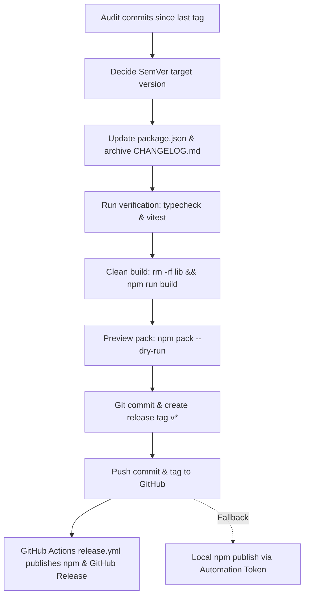

# Plugin Release Procedure & Skill

This skill documents the standard operating procedure (SOP) for releasing versions of `@eddyskywalker/dsh-chatgpt-subscription`. It covers commit auditing, SemVer decisions, CHANGELOG archiving, dual-baseline verification, clean build enforcement, Git tagging, automated CI publishing, and local fallback publishing.

---

## 1. Release Flow Overview



1. **Commit Audit & SemVer**: Compare commits from the last release tag to `HEAD` and determine the version number.
2. **Version & Changelog Sync**:
   - Update `"version"` in `package.json`, `package-lock.json` (root + `packages[""]`), and `PLUGIN_VERSION` in `src/compat.ts`.
   - In `docs/CHANGELOG.md`, move items under `## Unreleased` into a new `## <version> - YYYY-MM-DD` section, leaving a fresh `## Unreleased` placeholder above it. Keep release notes **concise and user-facing** (1–2 plain-language sentences per item; never dump internal function/variable names, package lists, or test-count logs into `docs/CHANGELOG.md`).
3. **Verification & Clean Build**:
   - Check `git status` to ensure no stray temporary files exist (e.g. `pnpm-lock.yaml` / `pnpm-workspace.yaml` — this repo uses **npm** exclusively).
   - Run `npx tsc -b --force` (after shared type or harness bumps), `npm run typecheck`, and `npm test`.
   - Wipe `lib/` and rebuild (`rm -rf lib && npm run build`) to ensure no deleted source declarations leak into the bundle.
   - Run `npm pack --dry-run` to preview published files.
4. **Git Commit & Tag**:
   - Commit changes: `git commit -m "chore(release): bump package version to <version>"`.
   - Create annotated/lightweight tag: `git tag v<version>`.
5. **Push & CI Publishing**:
   - Push to GitHub: `git push origin master` and `git push origin v<version>` (or `--tags`).
   - The `.github/workflows/release.yml` workflow triggers on `v*` tags, extracting release notes from `docs/CHANGELOG.md`, publishing to npm via `secrets.NPM_TOKEN`, and creating the GitHub Release.

---

## 2. Step-by-Step Procedure & Commands

### Step 1: Audit Commits & Determine Version

```powershell
# 1. Find the latest release tag
git describe --tags --abbrev=0

# 2. View commits since the last release tag
git log $(git describe --tags --abbrev=0 2>$null || "HEAD~10")..HEAD --oneline
git status

# 3. Choose SemVer increment:
# - Patch (e.g. 0.13.1 -> 0.13.2): Bug fixes, error logging, compatibility tweaks.
# - Minor (e.g. 0.13.1 -> 0.14.0): New features, provider lines, UI redesigns.
# - Prerelease (e.g. 0.13.2-alpha.1): Test builds (must be published with --tag alpha).
```

### Step 2: Update Versions & Archive `docs/CHANGELOG.md`

1. **Sync version across three files** (a unit test asserts `PLUGIN_VERSION === package.json.version`, and CI runs `npm ci` against `package-lock.json`):
   - `package.json`: `"version": "<version>"`
   - `package-lock.json`: root `"version"` and `packages[""].version`
   - `src/compat.ts`: `export const PLUGIN_VERSION = '<version>' as const`

2. **Archive `docs/CHANGELOG.md` (concise, user-facing prose only)**:
   Move current `## Unreleased` items into `## <version> - YYYY-MM-DD`, keeping a fresh `## Unreleased` block at the top.
   - **Writing rule**: write for end users — 1–2 concise sentences per bullet describing user-visible changes and impact. Never dump internal symbol/function names, file paths, or multi-generation test-count logs here (keep detailed technical audit & verification numbers inside `.dsh/skills/dsh-harness-upgrade/references/<ver>.md`).
   ```markdown
   # Changelog

   ## Unreleased

   ## <version> - YYYY-MM-DD

   - **[line / area] Short user-facing summary**: Plain-language description of what changed and why it matters.
   ```

### Step 3: Verification & Clean Build

As noted in `AGENTS.md`, `lib/` is incremental and keeps declaration files of deleted sources. **Always clean before rebuilding**, and check `git status` for stray files (never commit `pnpm-lock.yaml` / `pnpm-workspace.yaml`):

```powershell
# 1. Force full TypeScript check (avoids stale .tsbuildinfo) + test/scripts check
npx tsc -b --force
npm run typecheck

# 2. Full test suite (verifies PLUGIN_VERSION sync & BOM-free package integrity)
npm test

# 3. Clean build
if (Test-Path lib) { Remove-Item -Recurse -Force lib }
npm run build

# 4. Pack dry-run to verify included files
npm pack --dry-run
```

### Step 4: Git Commit & Tag

```powershell
# 1. Verify no stray untracked files (e.g. pnpm-lock.yaml)
git status -sb

# 2. Stage release metadata
git add package.json package-lock.json src/compat.ts docs/CHANGELOG.md

# 3. Commit with conventional prefix
git commit -m "chore(release): bump package version to <version>"

# 4. Tag with v prefix (must match v* for GitHub Actions)
git tag v<version>
```

### Step 5: Push & CI Automated Release

```powershell
# Optional: Set local proxy if GitHub connection stalls
# $env:all_proxy="http://127.0.0.1:7890"

# Push branch and tag
git push origin master
git push origin v<version>
```

Once pushed, GitHub Actions `.github/workflows/release.yml` will automatically:
1. Validate types and run the test suite.
2. Clean and build production assets.
3. Extract matching release notes from `docs/CHANGELOG.md`.
4. Publish to npm registry using `NPM_TOKEN`.
5. Create a GitHub Release with the extracted notes and upload the `.tgz` tarball.

---

## 3. Automated One-Command Helper

A release helper script is available at `.dsh/skills/release-plugin/scripts/release.mjs`. You can trigger it via npm:

```powershell
# Bump and release a specific version
npm run release 0.13.2
```

This helper automatically handles updating `package.json`, archiving `CHANGELOG.md`, running `typecheck` and `test`, cleaning `lib/`, compiling, committing, and tagging.

---

## 4. Local Fallback Publishing (Bypassing 2FA)

If GitHub Actions is unavailable or immediate publishing is required:

```powershell
# 1. Verify npm identity
npm whoami

# 2. Publish (Automation Token configured in ~/.npmrc bypasses 2FA)
# For stable:
npm publish --access public

# For prereleases:
npm publish --access public --tag alpha
```

---

## 5. Traps & Invariants

1. **`lib/` Stale Files**: Never publish without `rm -rf lib && npm run build`. The build cache does not track deleted source files.
2. **Version Triple-Sync**: `package.json`, `package-lock.json` (root + `packages[""]`), and `src/compat.ts` (`PLUGIN_VERSION`) must all match. A stale `PLUGIN_VERSION` fails `responses-client.test.ts`; a drifted lockfile breaks `npm ci` in CI.
3. **npm-Only Repo**: Never commit `pnpm-lock.yaml` or `pnpm-workspace.yaml` generated during local debugging.
4. **BOM-Free Files & GitHub Release Edits**: Never save repo files with a UTF-8 BOM (`package-integrity.test.ts` fails). If editing a published GitHub Release via `gh release edit v<ver> --notes-file <file>` on Windows PowerShell, pass a BOM-free UTF-8 file rather than piping through PowerShell stdout (which can prepend `\uFEFF`).
5. **Prerelease Tags**: npm 11+ refuses to publish prereleases without an explicit `--tag <dist-tag>`.
6. **Automation Tokens vs Publish Tokens**: Always use an `Automation` token in `~/.npmrc` and CI secrets; `Publish` tokens require interactive 2FA OTP for write actions.
